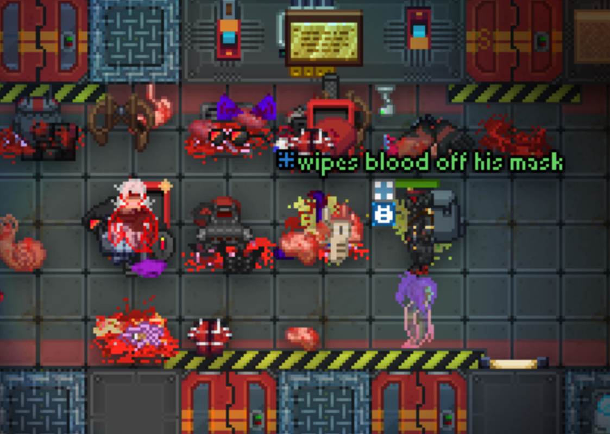

+++
title = "We are so BACK newsletterees!!!"
date = 2025-09-01
+++

## We are so BACK newsletterees!!!
## /TG/ Monthly Newsletter #3
Welcome to the third /tg/ monthly newsletter!
This is a basic summary of all the going-ons and happenings in TGstation in the last month, along with any upcoming events and highlights.

## General Docket
I have returned! With the help of Ezel and after a long absence, I am pleased to have returned with the /TG/ Newsletter! 
There has been some going ons within the upper management- namely there is no host role anymore. Scriptis is now a GameMaster, but will still work on server infrastructure. Timberpoes is still a GameMaster, but has been put in charge of managing blacklists. 
In addition, we are now accepting donations again! This time- as a recognized 501c3 non-profit. You can donate at https://opencollective.com/tgstation13 . This means there is a lot more legal requirements for the money to be spent on tgstation, and books will be published regularly.

## Upcoming Events
The Headmin Election is just around the corner.. so be ready for that! No events are planned otherwise.

## The Last 30 Days of Policy
- [Roundstart Automatic Alert Level is disabled on Manuel](https://forums.tgstation13.org/viewtopic.php?t=38876)
- Relatively dry month for Policy changes...

## Open Policy That Might be Important to You
- [Holding Security to a Higher Standard](https://forums.tgstation13.org/viewtopic.php?t=39028)
- [Transparency Increase in blacklisting](https://forums.tgstation13.org/viewtopic.php?t=38984)
- [Mass Destruction Speedrunning as an Antag](https://forums.tgstation13.org/viewtopic.php?t=38983)
- [Manuel Dynamic Config](https://forums.tgstation13.org/viewtopic.php?t=38947)
- [Enforce the Goal of Roleplay Rule 5](https://forums.tgstation13.org/viewtopic.php?t=38824)

## Config Changes
- [Inactive players are no longer kicked from Terry or Sybil](https://forums.tgstation13.org/viewtopic.php?p=783079#p783079)

## Notable or Cool Prs [Written by Ezel]
- [Replaces Most Emergency vendors with First aid stations](https://github.com/tgstation/tgstation/pull/92677)[by **MrMelbert**]
- [Adds plumbing to toilets](https://github.com/tgstation/tgstation/pull/92695)[By **SmArtKar**]
- [Girlifies His grace](https://github.com/tgstation/tgstation/pull/92658)[By **Lelandkemble**]
- [Art gallery app can now be downloaded on PDA's and laptops](https://github.com/tgstation/tgstation/pull/92615)[By **Ghommie**]
- [Rare Earths! Advanced soils for botany](https://github.com/tgstation/tgstation/pull/92513)[By **Krysonism**]
- [Accounting Glowup: Advances, Pay raises and cuts, and more](https://github.com/tgstation/tgstation/pull/92419)[By **MrMelbert**]
- [Adds a furnace that grants space protection to nearby people](https://github.com/tgstation/tgstation/pull/92342)[By **JohnFulpWillard**]
- [Adds 5 Bond-tier gadgets to the Spy's reward pool](https://github.com/tgstation/tgstation/pull/92481)[By **MrMelbert**]
- [Heretic Antagonist Full Overhaul](https://github.com/tgstation/tgstation/pull/92119)[By **EnterTheJake**]
- [Adds the surplus energy sword; the mall katana of the future.](https://github.com/tgstation/tgstation/pull/92544)[By **necromanceranne**]
- [Icebox ruin: RoroCo glove factory](https://github.com/tgstation/tgstation/pull/92473)[By **Thunder12345**]
- [The Chain of Command can now give a speed boost by whipping other players](https://github.com/tgstation/tgstation/pull/92387)[By **Rhials**]
- [Mobs with binary channel access now recieve a "New Host" message when a new AI is brought online](https://github.com/tgstation/tgstation/pull/92334)[By **zxaber**]
- [Organ Growing Kit | Coroner Cytology Cargo Content (1/2)](https://github.com/tgstation/tgstation/pull/92108)[By **Time-Green**]
- [1X3 ICEBOX | Wilderness Expansion](https://github.com/tgstation/tgstation/pull/91920)[By **Time-Green**]
- [Bow revisit, they hit harder, there are more sprites, there is a new bow made of bone. Really live that ranger fantasy.](https://github.com/tgstation/tgstation/pull/92809)[By **necromanceranne**]

## Admin Rankings
- Thecrystalship has been promoted to Game Admin.
- Iansdoor has been returned to Game Admin.
- Kinnebian has been returned to Game Admin.
- Scriptis has retired to GameMaster
- Kubisopplay has been promoted to Game Admin.

## Picture of the Month!
This is our monthly competition for the person who sends in the best picture on /TG/ in the last month. Submissions can be put in through the [relevant players club forum](https://forums.tgstation13.org/viewtopic.php?p=783637#p783637) or by directly messaging @kinneb on discord.
The winner of this month is 'Mel', with a syncronized double explosion routine in front of a local secoff! Nice tricks!

As such, they'll be receiving a major antag token, redeemable for wizard, blob, etc.

In addition, we will be asking for comics! If anyone wants to make a shitty 6 panel comic or the such to be put in the newsletter, they will also receive a major antag token and be attached to the end of the newsletter. (Thanks to Jamarkus for the Idea!)
Thanks for reading, and thanks to Ezel and everyone for waiting!

