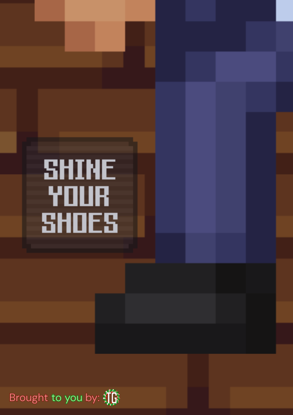

+++
title = "Toolbox Tournament VII"
date = 2025-12-02
+++

## /TG/ Monthly Newsletter #6
Welcome to the sixth /tg/ monthly newsletter! 
This is a basic summary of everything that’s happened on /tg/ in the last month, and what’s coming next.

## General News
I’m Sonnzer, the new newsletter editor; replacing ImprovedName. I am aware that the editors seem to leave within only a few editions, so hopefully I’ll stick around for a good while longer. Also, happy December!

The Toolbox Tournament was hosted on Nov. 8th, raising money for the Cancer Research Institute. CRI is a non-profit charity organization founded in 1953 that funds  research to treat and potentially even cure cancer through the use of immunotherapy. *The Black Bulls* team, with Sk1wass3r, saint1453, and itzfatdog taking first place, followed by *Team Bama* and *The Honkmother Preachers* respectively. A big congratulations to these winning teams, and those who participated!

The Toolbox Tournament managed to collect a grand total of **$10,000** from community donations, smashing the original goal of $8000, so a huge thank you to all those who donated!

The Great Space Station 13 Survey was a Space Station 13-wide initiative to collect and analyze data about the playerbase of /tg/ and also the greater community as a whole. The survey has concluded and the data is currently being collated into some nice, readable graphs for everyone to gawk at.

## Upcoming Events
Please see the addendum of the newsletter.

## The Last 30 Days of Successful Policy changes
- [The Bomb-Cap is Too Damn High](https://forums.tgstation13.org/viewtopic.php?t=39323)

## Open Policy That Might be Important to You
- [remove the streaming ban](https://forums.tgstation13.org/viewtopic.php?t=39366)
- [NONHUMAN HEADS REQUEST 2025/2](https://forums.tgstation13.org/viewtopic.php?t=39305)
- [Ban slurs from the discord](https://forums.tgstation13.org/viewtopic.php?t=39339)
- [keep map hate out of IC](https://forums.tgstation13.org/viewtopic.php?t=39362)

## Config Changes
Manuel’s hard-cap was increased from 60 to 65. 
Terry has had their dynamic settings tweaked, read more [here](https://github.com/tgstation-operations/server-config/pull/106).

## Notable or Cool Prs
- [Adds a new antag, the Blood Worm](https://github.com/tgstation/tgstation/pull/93787) [By **RikuTheKiller**]
- [Spooky Scary Supreme Surgery (Rework)](https://github.com/tgstation/tgstation/pull/93697) [By **MrMelbert**]
- [Mild Boxing Tweaks](https://github.com/tgstation/tgstation/pull/93963) [By **NecromancerAnne**]

## Admin Rank Changes
- GamerAndYeahMick/Burgerman has retired.
- Scriptis has retired.
- JackMoloney has been promoted to Game Admin.
- Xzero314 has been promoted to Admin Trainer.
- Llaren Hlaalo has been promoted to Admin Trainer.

## Picture of the Month
As is tradition, we give out an antag token to those who send a funny image to the newsletter editor and successfully get picked out of all the submissions. We do not have any images currently, but for the next edition, if you would like to submit an image, please DM me at <@749255850387832924>, or email me at sonnzer@tgstation13.org with your submission for a chance to win.

Oh, and one last thing…

## It's Getting Cold Outside...
Temperatures are dropping in the Northern Hemisphere and winter's on its way! The Events Team has something in the works to keep spirits warm and cozy despite the ice and snow. Can you guess what's coming?

If you'd like to contribute to the upcoming Seasonal Event, we welcome mappers, coders, and spriters to reach out to Rave Radbury and twaticus. Beginner or veteran, all levels of experience are welcome to participate!

