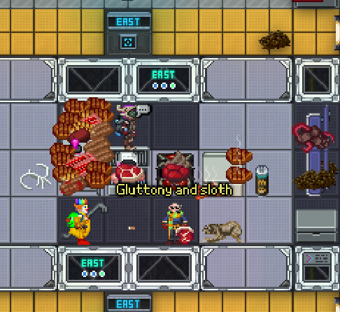

+++
title = "HeadCoder Swap"
date = 2026-06-01
+++

## /TG/ Monthly Newsletter #12
Welcome to the 12th /tg/ monthly newsletter! 
This is a basic summary of all the going-ons and happenings in TGstation in the last month, along with any upcoming events and highlights.

## General Docket
Hi all, happy June and happy Pride Month. You may have noticed that we’ve got a new and swaggy server icon. It’s animated too! Check out all the flags as it spins hypnotically.

In other news, due to my rampant incompetence, I regrettably forgot something very important. We have a new head coder! If you weren’t aware, MrMelbert was made a Head Coder all the way back in April and I had forgot to cover it prior. I suppose it’s rather late than never, though? Sorry Melbert!

On a better note, our weekly scheduled rounds for Manuel and Terry are still going strong. Pop in to your favourite server every Saturday and Friday respectively to play the game and have some fun.

## Upcoming Events
The Manuel and Terry weekly scheduled rounds, which you can find out more about in the events tab on the Official Discord.

## The Last 30 Days of Successful Policy changes
N/A

## Open Policy That Might be Important to You
- [Security Meta Protection Addition. MRP or Global?](https://forums.tgstation13.org/viewtopic.php?t=39724 )
- [Codify permanent non-consensual changing of species, appearance, and gender as rule 1 breaks](https://forums.tgstation13.org/viewtopic.php?t=39702 )
- [Lower the population threshold to enable heretics](https://forums.tgstation13.org/viewtopic.php?t=39711 )

## Config Changes
April 30th - [Blood brothers have a lower weight on Terry and are non repeatable.](https://github.com/tgstation-operations/server-config/pull/148 )

## Notable or Cool Prs
- [Adds the Limper quirk](https://github.com/tgstation/tgstation/pull/96200 ) [By **TheRyeGuyWhoWillNowDie**]
- [Walking in snow leaves snowprints, snowstorms clear them](https://github.com/tgstation/tgstation/pull/95569 ) [By **MrMelbert**]
- [Enhances LARP by allowing the Captain to dress like Napoleon](https://github.com/tgstation/tgstation/pull/96156 ) [By **theselfish**]

## Admin Rank Changes
- Dragomagol has retired.
- StrandsofIvy has retired.

## Picture of the Month
Congrats to Kuma, Webcomic Artist for winning with their sinful image of what you should never, ever partake in on a Nanotrasen station. Gluttony and Sloth. Work hard on your station. Do not succumb to the curse of the sloth nor of the chefs cooking. Seriously.

You too can submit images in screenshots-general where you could possibly win a major antag token! May the best win for next edition of the newsletter!

