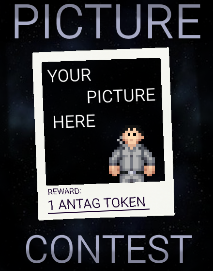

## TG Monthly Newsletter #1

Welcome to the first of (hopefully many) TG's monthly Newsletter!
This is a basic summary of all the going-ons and happenings in TGstation in the last month, along with any upcoming events and highlights.

## General Docket
Thanks to the tireless efforts of the ops team, the TG Wiki is back in functionality! Its a bit slow at the moment, but they are currently working to fix it up.

We are now on BYOND 516! If you aren't on BYOND 516, you will find yourself having to update.

The headmin election results are in! Here are your ~~new overlords~~ winners:
- Player Vote: **Striders13**
- Admin Vote: **Rex9001**
- Host Vote: **iain0**

Happy April fools everyone! I hope you enjoyed the silly pr's that got made for it, there was an incredible amount of effort this time around.

## Upcoming Events:
On the 12th, 7:00pm UTC- We are running the station purge event on terry! This is a player submitted event that invokes the purge. A lawless wasteland for 30 minutes. Will you survive?
This is a **player event** submitted by Epsilon on the events channel in discord! Feel free to submit your own there!

## Notable PRs:
- [Burning paper now works two ways](https://github.com/tgstation/tgstation/pull/90307) - **MrMelbert**
- [You can cuff people to the tram rails](https://github.com/tgstation/tgstation/pull/90293) - **Jacquerel**
- [friendship truly IS robust](https://github.com/tgstation/tgstation/pull/90293) -  **iamgoofball** [April fools]
- [what if we did the wallening again](https://github.com/tgstation/tgstation/pull/90385) - **Kapu1178** [April fools]
- [I can see what you think](https://github.com/tgstation/tgstation/pull/90372) - **mcbalaam** [April Fools]

## The last month of policy:
- [you can say erp in ooc again](https://forums.tgstation13.org/viewtopic.php?t=38382)
- [no chicken fights](https://forums.tgstation13.org/viewtopic.php?p=773710#p773710)
### These discussions might be important to you! [open policy discussion]:
- [add respawn to sybil](https://forums.tgstation13.org/viewtopic.php?t=38415)
- [reshackle malfunctioning ais](https://forums.tgstation13.org/viewtopic.php?t=38424)
- [policy regarding public config GitHub](https://forums.tgstation13.org/viewtopic.php?t=38500)

## Changes to the Config:
- [antag tweaks for lower pops](https://forums.tgstation13.org/viewtopic.php?t=38500)
- [516 is now the minimum version](https://github.com/tgstation-operations/server-config/pull/32)
- Birdshot has now been disabled!

## Admin Rankings
Distrilul / distributivgesetz has been promoted to Game Admin!

## Picture of the Month!
There's nothing here- for now!
**Every month, we will be offering an antag token to the person who sends in the best picture**! This picture doesn't have to be taken using an in-game camera, and can be of anything happening on TGstation.

The funniest or most impressive picture taken will be posted in the newsletter, with the winner credited and given a big ol' antag token.

These can be sent in by directly messaging kinnebian on discord or through a message on the forums.

