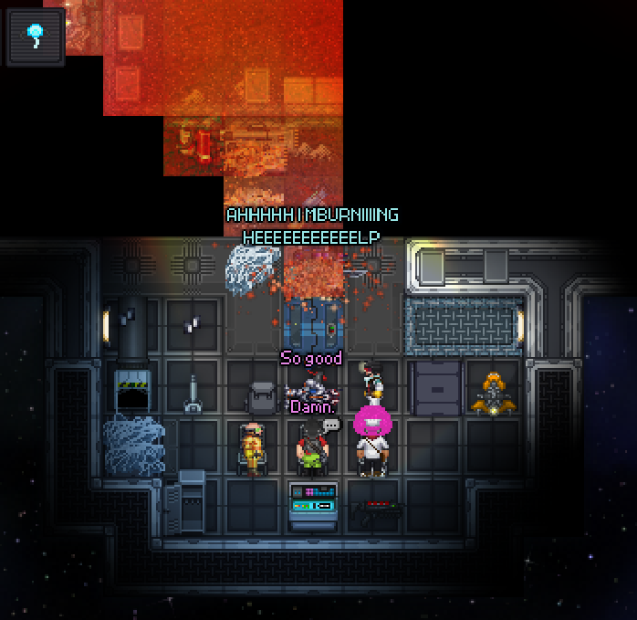

## /TG/ Monthly Newsletter #9
Welcome to the 9th /tg/ monthly newsletter! 
This is a basic summary of all the going-ons and happenings in TGstation in the last month, along with any upcoming events and highlights.

## General Docket
We march into March steadfast, leaving behind all that February misery. Because February is the most miserable month. I hope yours was alright.

In recent news, Spookuni has decided to set up a weekly admin coordinated round for Manuel! The first coordinated round was on the 28th of February, and brought us to a staggering **80+** pop count! Thank you to all admins involved and to the players for showing up and having a good time.

## Upcoming Events
Weekly Admin Coordinated Round on Manuel: 07/03

## The Last 30 Days of Successful Policy changes
N/A

## Open Policy That Might be Important to You
- [Revolution should be solo-ruleset/own gamemode again](https://forums.tgstation13.org/viewtopic.php?t=39334)

## Config Changes
N/A

## Notable or Cool Prs
- [Refactors gauze, adds Tourniquets](https://github.com/tgstation/tgstation/pull/95041) [By **MrMelbert**]
- [Adds the pump-action grenade launcher and updates the existing break-action ballistic grenade launcher with a new sprite](https://github.com/tgstation/tgstation/pull/95244) [By **NecromancerAnne**]
- [NanoPaint: The Modular Computer Paint App](https://github.com/tgstation/tgstation/pull/95213) [By Y0SH1M4S73R]

## Admin Rank Changes
- Iansdoor has retired.
- Xzero314 has been made a Head Admin in the interim.

## Picture of the Month
Congratulations to Bengt Bengtsson (Thesamon) for winning the picture contest, and their major antag token, with this image that simply captures the nature of a good escape shuttle. Take in that heat.

Be sure to try and win the contest through submitting your images, through our **NEW** and **IMPROVED** method of posting in the special image contest thread in screenshots-general!
