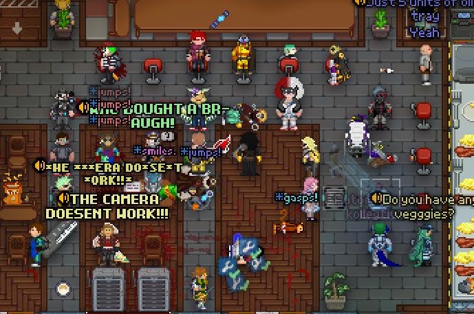

## /TG/ Monthly Newsletter #10
Welcome to the 10th /tg/ monthly newsletter! 
This is a basic summary of all the going-ons and happenings in TGstation in the last month, along with any upcoming events and highlights.

## General Docket
I’d like to announce that I am quitting the newsletter after this one. Haha just kidding. April fools!

Something that isn’t a joke, however, is the release of the results for our Head Admin election! Here’s the results;

Player Vote - Dunham
Admin Vote - Dendydoom
Host/Headmin Vote - Xzero314

Congratulations to our winners, and may this term be a good one.

Additionally, following the success of the Manuel weekly round, Terry has one too now! Please see the events calendar button for this server for more info.

## Upcoming Events
The Manuel and Terry designated weekly rounds; please see events calendar for dates.

## The Last 30 Days of Successful Policy changes
N/A

## Open Policy That Might be Important to You
N/A

## Config Changes

## Notable or Cool Prs
- [TTS 3.0](https://github.com/tgstation/tgstation/pull/95369) [By **Iamgoofball**]
- [Adds the IDC-27 book for viruses](https://github.com/tgstation/tgstation/pull/95465) [By **MrMelbert**]
- [Slot Machine DLC](https://github.com/tgstation/tgstation/pull/95513) [By **timothymtorres**]

## Admin Rank Changes
- StrandsofIvy has been promoted to Admin Trainer.
- Winters1 has been promoted to Trial Admin.
- Taggamergame2 has been promoted to Game Admin.
- Rex9001 has unretired as a Game Master.
- Scriptis has unretired as a Game Admin
- Vect0r has been promoted to Trial Admin.
- Dunham has been made a Head Admin Elect awaiting transition.
- Dendydoom has been made a Head Admin Elect awaiting transition.

## Picture of the Month

Congratulations to Ouroborus for winning the competition with their cool image of our first weekly admin ran Terry round. There’s some fresh bar RP happening. Classic.

Be sure to run in the competition to win a major antag token by sending it in the dedicated thread made in screenshots-general.

