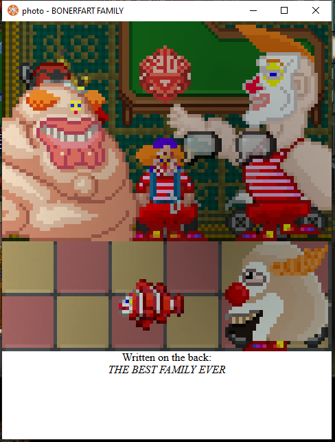

## /TG/ Monthly Newsletter #11
Welcome to the 11th /tg/ monthly newsletter! 
This is a basic summary of all the going-ons and happenings in TGstation in the last month, along with any upcoming events and highlights.

## General Docket
Hey guys. All these weekly rounds have been a blast. But… something’s missing. I can’t quite put my finger on it… I guess it wasn’t important if I forgot?

Oh, wait. Sybil! We have a Sybil round running this Sunday at 4pm EST. You can find an event on the events calendar here on the discord.

We also have a colouring contest happening, ran by the potentially infamous Viola Lin (@thus.smoke.zarathustra). We’ve all seen your banners… The contest is to colour in line art and ALL participants get an antag token, with the first place winners of each of the three line art pieces getting a **$10 Steam or Amazon gift card**! Additionally, the overall winner gets a **$25 dollar Steam or Amazon gift card**! You can find out more [here](https://forums.tgstation13.org/viewtopic.php?t=39673).

## Upcoming Events
The Manuel and Terry designated weekly rounds, along with the new Sybil round; please see events calendar for dates.

## The Last 30 Days of Successful Policy changes
N/A.

## Open Policy That Might be Important to You
- [Restrict Changeling/Blood Worm’s laxed murder restriction on MRP](https://forums.tgstation13.org/viewtopic.php?t=39694)
- [Remove or lower PANIC_BUNKER from 90](https://forums.tgstation13.org/viewtopic.php?t=39695)

## Config Changes
2nd of April: CE and CMO are now allowed to be non-humans.

## Notable or Cool Prs
- [Adds a more fitting Cybersun reinforcement outfit](https://github.com/tgstation/tgstation/pull/95918) [By **NecromancerAnne**]
- [Modernizes Central Command’s ERT wing](https://github.com/tgstation/tgstation/pull/95727) [By **Pumpkin0**]
- [Basic beepskies and some ED209 additions](https://github.com/tgstation/tgstation/pull/95783) [By **Ben10Omnitrix**]

## Admin Rank Changes
- Xzero314 has been promoted to Head Admin.
- Dendydoom has been promoted to Head Admin.
- Dunham has been promoted to Head Admin.
- Pumpkin0 has unretired as a Game Admin.
- Rageguy505 has unretired as a Game Admin.
- TheSamon has been promoted to Game Admin.
- Nobodyofimportance has retired as a Trial Admin.
- StrandsofIvy has been promoted to Game Master.
- Dragomagol has retired as a Game Master.

## Picture of the Month
Congratulations to Dunham for winning the picture contest with his family photo, depicting him with his mother on the left, father on the right, pet fish at the bottom, and cousin by the bottom right. What an amazing family. Picturesque.

