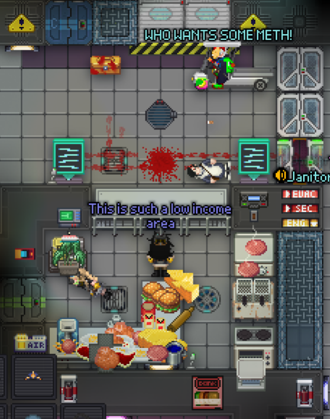

## /TG/ Monthly Newsletter #13
Welcome to the 13th /tg/ monthly newsletter! 
This is a basic summary of all the going-ons and happenings in TGstation in the last month, along with any upcoming events and highlights.

## General Docket
Hi all, welcome to July, the start of blistering heatwaves and the end of Pride month. Make sure to stay hydrated this coming summer, especially for all you fellow Britons.

We have a new server. Manuel 2. What’s so new about it? Umm… Nothing, really. It’s just an overflow for Manuel, when those 90 pop rounds just aren’t your style. No unique name has been given to it as it’s strictly an overflow server, but following our naming conventions, I give a +1 to the unofficial name of Polly.

## Upcoming Events
The upcoming Manuel and Terry scheduled rounds on a Saturday and Friday weekly respectively. Please view the events button/calendar button on the discord for more information.

## The Last 30 Days of Successful Policy changes
- [Security Meta Protection Addition](https://forums.tgstation13.org/viewtopic.php?t=39724 )
- [ICE ICE BABY (Remove lowpop icebox)](https://forums.tgstation13.org/viewtopic.php?t=39720 )

## Open Policy That Might be Important to You
- [Tutorialbaiting](https://forums.tgstation13.org/viewtopic.php?t=39734 )

## Config Changes
Icebox is no longer a lowpop map.
Maps no longer get a pity tally; play rates are 100% accurate for the votes they get.
Manuel dynamic changes, please see [here](https://github.com/tgstation-operations/server-config/pull/152) for more info.

## Notable or Cool Prs
- [Readds Kilostation](https://github.com/tgstation/tgstation/pull/96447) [By **TheRyeGuyWhoWillNowDie**]
- [Rebalance the work camp again](https://github.com/tgstation/tgstation/pull/96731) [By **Jacquerel**]
- [Significant changes to Heretic spells/rituals](https://github.com/tgstation/tgstation/pull/95796 ) [By **MrMelbert**]

## Admin Rank Changes
- Johnhenryeton has been promoted to Trial Admin.
- MrrFiish has a new ckey, now going by Fiishy.

## Picture of the Month
Congrats to Jared Rysenburger | G.R.E.G. for winning the contest, with their picture of their local fast food place in the low income area known as Freyja, the Ice Moon. Perhaps it’s a new venture by Big Blues Burger Grill?

Every month we have a picture contest, so please make sure to check it out, it’s the pinned thread in screenshots-general, and you can win a major antag token for getting it featured in the newsletter!

