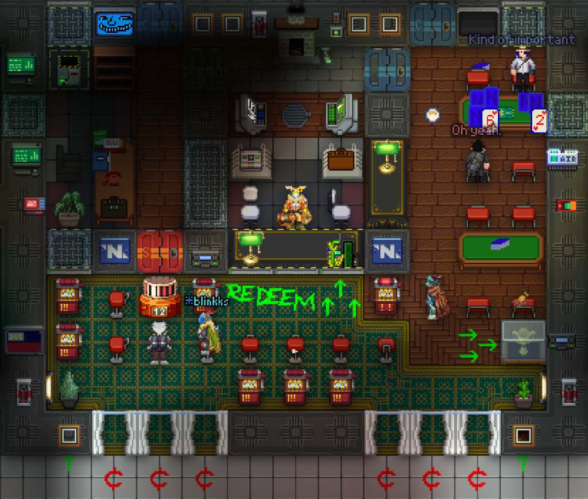

## /TG/ Monthly Newsletter #14
Welcome to the 14th /tg/ monthly newsletter! 
This is a basic summary of all the going-ons and happenings in TGstation in the last month, along with any upcoming events and highlights.

## General Docket
Happy August to you all, and apologies for the slight delay in release, but finally we’ve got our much beloved newsletter out, so, hey, the ends justify the means.

It was a bit slimy of me to delay it, sure, but… something else is a bit slimy… Jellypeople, I reckon. Jellypeople are now a roundstart species to choose in character setup. Jellypeople naming conventions have also been added, which can be found in the Rule 3 Precedents. Enjoy getting gloopy in round, as I believe they’re here to stay this term!

Along with that, another egregious delay, worse than the delay of this newsletter, is the announcement of the artwork contest winners we held a few months back. Better late than never! We had cardeco (.seal enjoyer) as our overall winner, with secc and Meo/Nyla Foster winning their respective image categories. Well done to the winners and also to every other participant for their artwork!

Lastly, we have a new change to our map config! Kilostation, which may some remember, ever infamous for the HoPline suicides, is back, replacing Wawastation. It also replaces Icebox as a lowpop map, so please enjoy endless Meta and Kilo for when you play with a lower pop.

## Upcoming Events
The upcoming Manuel and Terry scheduled round, held on Friday and Saturday every week respectively. Check the events calendar on the discord for more information.

## The Last 30 Days of Successful Policy changes
N/A.

## Open Policy That Might be Important to You
- [Crew should treat fugitives like fugitives](https://forums.tgstation13.org/viewtopic.php?t=39731)

## Config Changes
Wawastation has been removed from map rotation, with Kilostation replacing it.

## Notable or Cool Prs
- [AI Law Rework 2](https://github.com/tgstation/tgstation/pull/96555) [By **MrMelbert**]
- [Revenant DLC - New Abilities](https://github.com/tgstation/tgstation/pull/97114) [By **timothymtorres**]
- [Monkeys now yakety sax and shove in combat](https://github.com/tgstation/tgstation/pull/97067) [By **CabinetOnFire**]

## Admin Rank Changes
- Wineallwine has retired.

## Picture of the Month
Congratulations to Cultist of Pupcup for winning the picture contest, with their submission of their custom built casino. Casino RP is the evolved form of Bar RP, for the uninformed.

You can win too, if you submit to the contest in screenshots-general. Be it a screenshot in game, original art you’ve made that’s SS13 themed, or similar, you can submit it and vie for the major antag token on offer for the winner.

