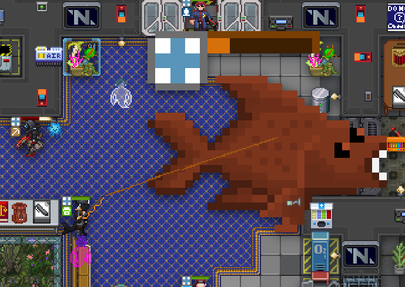

## /TG/ Monthly Newsletter #15
Welcome to the 15th /tg/ monthly newsletter! 
This is a basic summary of all the going-ons and happenings in TGstation in the last month, along with any upcoming events and highlights.

## General Docket
Happy September, all. We’re close to the start of Autumn (or Fall for you yanks), and maybe finally we can chill out after all this Summer heat.

The heat recently has been simply too much. I feel like I’m about to melt into… slime…

Well, I’m not. No one is. Except for the Jellypeople who are now available as a roundstart species. But they’re not really slime. They’re jelly. Very different.

The Jellypeople species is now available for you to pick! Be wary, they’re a bit allergic to medicine. I think they prefer yu(c)ky stuff.

## Upcoming Events
The Manuel and Terry scheduled rounds, every week on Saturday and Friday respectively. See the events calendar on our Discord for more info.

## The Last 30 Days of Successful Policy changes
- [Enable Roundstart Jellypeople](https://forums.tgstation13.org/viewtopic.php?t=39762)

## Open Policy That Might be Important to You
- [Drone Laws - Definition of an “Interaction”](https://forums.tgstation13.org/viewtopic.php?t=39766)

## Config Changes
N/A

## Notable or Cool Prs
- [Adds a fully functional boombox](https://github.com/tgstation/tgstation/pull/97357) [By **ArcaneMusic**]
- [Revheads can set a conversion guidline](https://github.com/tgstation/tgstation/pull/97678) [By **MrMelbert**]
- [Adds limited character height options](https://github.com/tgstation/tgstation/pull/97519) [By **MrMelbert**]

## Admin Rank Changes
- AurumDude has been promoted to Game Admin.
- JohnHenryEton has been promoted to Game Admin.
- Vect0r has been promoted to Game Admin.

## Picture of the Month
Congratulations to fallcat for winning the picture contest with this absolute winning catch of a carp. Everybody knows that big catches traditionally get onto newspapers, so that tradition will be honoured.

You can win too, with a major antag token up for grabs, who wouldn’t want to join in? Check the pinned thread in screenshots-general to try vie for a slice of the victory pie, see how I rhyme.

