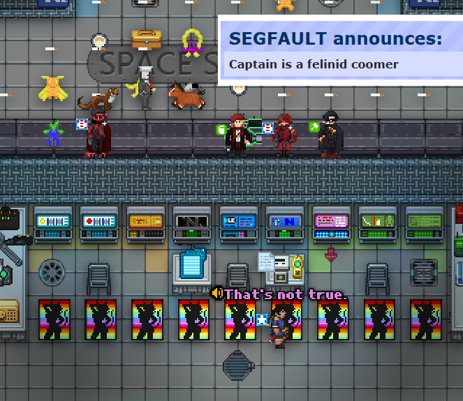

## /TG/ Monthly Newsletter #16
Welcome to the 16th /tg/ monthly newsletter! 
This is a basic summary of all the going-ons and happenings in TGstation in the last month, along with any upcoming events and highlights.

## General Docket
Hi all, apologies for such a belated post. All this bother with the new headmins would have anyone up in arms.

Oh, yeah, we have new headmins! The Headmin Election that was running through September has concluded, and we have new overlords to rule over us. Results as follows:

- Headmin Vote - Nox
- Admin Vote - OmegaDark
- Player Vote - Eton

A big congratulations to our winners, and thank you to all candidates for running this election.

Additionally, there is a mapping contest going on. Running from the first of October to November, which you can learn about [here](https://hackmd.io/@Arcane/rk25VCl5fe).

The prize for the grand winner of this contest is any steam game under $100, as well as another steam game under $100 graciously offered by Jamarkus{Ambivalent on TGUI}.

## Upcoming Events
The Terry and Manuel weekly scheduled rounds, on Friday and Saturday respectively. See the events calendar for more info.

## The Last 30 Days of Successful Policy changes
A lot of posts have been blitzed and closed, so you can check all the closed posts here.

## Open Policy That Might be Important to You
- Enable Respawns
- Remove Black Orbit

## Config Changes
N/A.

## Notable or Cool Prs
- [Cooking voucher instead of ingredient beacon](https://github.com/tgstation/tgstation/pull/97939) [By **MrMelbert**]
- [Ceruleans - A New Aquatic Species](https://github.com/tgstation/tgstation/pull/97787) [By **desertmote**]
- [New Achievements](https://github.com/tgstation/tgstation/pull/97890) [By **Jacquerel**]

## Admin Rank Changes
- JohnHenryEton is now a Head Admin Candidate, awaiting swap over.
- OmegaDarkPotato is now a Head Admin Candidate, awaiting swap over.
- NoxVS is now a Head Admin Candidate, awaiting swap over.

## Picture of the Month
Congratulations to Viola 林 Professional E-Girl for winning the picture contest with this picture of a completely ordinary Nanotrasen Captain. They’re not a “felinid coomer” and any suggestions otherwise will be served an immediate D-Notice. Thank you.

You can win a token too, through the monthly contest held in screenshots-general. Vie for your major antag token and get any normal antag you could get normally. That means no asking for Chrono Legionaire. I mean it.

